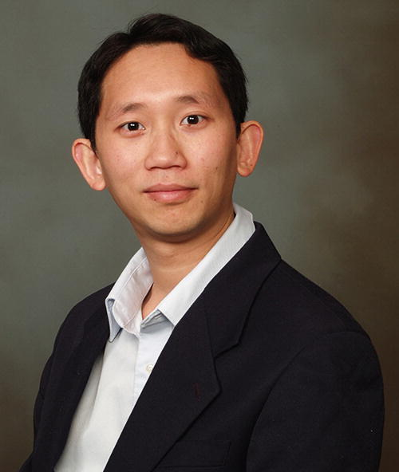
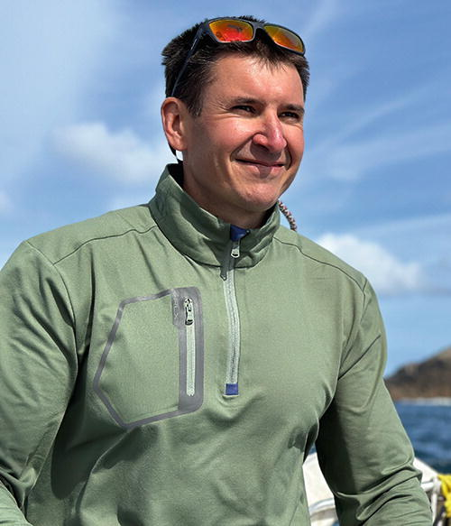

# About the Authors

Jason Yip

is a Databricks Most Valued Professional, recognized by Databricks for his exceptional technical expertise and commitment to the data and AI community. He serves on multiple advisory boards at Databricks, including the Partner Product Advisory Board and the Solution Architect Champion Advisory Board. He currently serves as Director of Data and AI at Tredence, a leading data science and analytics company, and is a Databricks Gold Partner. He advises Fortune 500 companies on implementing data and Generative AI strategies in the cloud. He is a top voice on Databricks and a former Microsoft employee who successfully led the Microsoft Corporate Finance big data transformation using Databricks.

Nikhil Gupta

is a seasoned data professional with over 20 years of experience in big data technologies, driving innovation and strategic growth in the field. Nikhil serves as a Solution Architect at Stripe and held the same role at Databricks. Nikhil leverages his expertise to help customers across various industries, including retail, CPG, financial services, banking, and manufacturing, modernize their data and AI implementations on the Databricks platform. His expertise spans a range of big data technologies, including data warehousing, data lakes, and real-time data processing, making him a trusted advisor for Fortune 500 companies.

Marcin Wojtyczka

is a Practice Lead Resident Solutions Architect at Databricks and the creator of the open-source **DQX** data quality framework. A former software engineer and data architect, he has spent years building large-scale data platforms and ML/AI systems. Today, he builds reusable libraries and frameworks that enhance and complement the Databricks platform, powering the next generation of data intelligence. Beyond the code, Marcin is a frequent speaker, an active open-source contributor, a product builder, and an expedition sailor.
