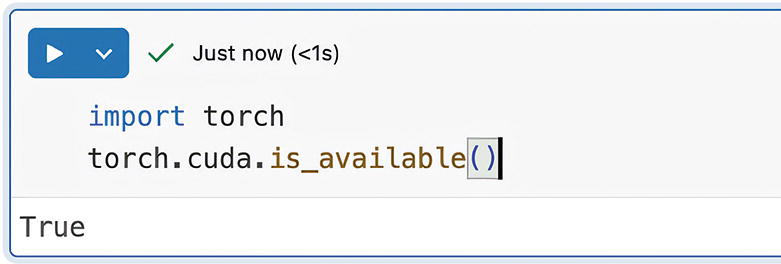

© The Author(s) 2026

J. Yip et al.Databricks Data Intelligence Platform<https://doi.org/10.1007/979-8-8688-2524-8%5F10>

# 10\. AI Runtime: Elastic Compute for AI Workloads

Jason Yip[1](A625176_2_En_10_Chapter) , Nikhil Gupta[2](A625176_2_En_10_Chapter) and Marcin Wojtyczka[3](A625176_2_En_10_Chapter)

([1](A625176_2_En_10_Chapter))

Redmond, WA, USA

([2](A625176_2_En_10_Chapter))

Livingston, NJ, USA

([3](A625176_2_En_10_Chapter))

Kappeln, Germany

When it comes to graphics processing units (GPUs), people undoubtedly think of Copilot or ChatGPT. No doubt that large language models are powered by a massive number of GPUs, and we will also discuss AI models in this chapter. One lesser-known limitation is the limited support for training traditional machine learning models on serverless CPU compute. The reason is that serverless is using the Spark Connect architecture. As shown in Figure [10-1](A625176_2_En_10_Chapter), the Spark Connect architecture decouples the Spark driver and the application layer or the execution environment. While the client-server architecture allows the core Spark engine and the execution environment to continue to evolve independently, the drawback is that the application must now access Spark via API, and it no longer has access to the low-level RDD API.

![This diagram explains how different tools and languages connect to Spark’s driver through the Spark Connect API. On the left, three groups are shown: modern data applications, IDEs and notebooks like Jupyter and PyCharm, and programming languages or SDKs including Go, R, and Python. Arrows point from each group to the Spark Connect API in the center, which acts as a bridge. On the right, Spark’s driver is detailed with components it manages: a multi-tenant application gateway, an analyzer, and three orange blocks representing the optimizer, scheduler, and distributed execution engine. The image highlights how various user tools interact with Spark’s internal processing system via a unified API, enabling efficient data processing and management.](./images/625176_2_En_10_Fig1_HTML.jpg)

Figure 10-1

Spark Connect architecture

## AI (Serverless GPU) Runtime

When it comes to serverless GPUs, we would probably compare them to virtual machines with GPUs installed. However, the software stack is equally important because, without suitable software, it will be hard to manage an array of machines ourselves, not to mention GPU communication, which makes the development of large language models so difficult. Fortunately, with the Spark Connect architecture and newly developed runtime and API, data scientists and AI researchers can now build custom models more easily. Figure [10-2](A625176_2_En_10_Chapter) shows the workflow of serverless GPU development. We will examine how to apply serverless GPU computing across the AI spectrum, including machine learning, deep learning, and LLM fine-tuning.

![The flow chart outlines a machine learning workflow starting with ingesting training data stored in tables and volumes, governed by a Unity Catalog. The data then moves to preparation, involving tools like Spark, notebooks, exploratory data analysis, data quality checks, and Delta Live Tables, ensuring a smooth shift from data engineering to training. Next, the AI Orchestrator and Tools stage includes platforms such as Training in Databricks Notebooks, TensorFlow, Ray, MLflow, DeepSpeed, Trainer, and PyTorch. This stage interacts with serverless GPU compute for loading base models, fine-tuning models, and registering customized models. The process is supported by MLflow and Unity Catalog for model registry and experimentation, emphasizing an integrated, scalable system for managing data, training, and model deployment.](./images/625176_2_En_10_Fig2_HTML.jpg)

Figure 10-2

AI runtime workflow

## Serverless API at a Glance

### Serverless CPU for Machine Learning

Distributed machine learning is possible in Spark Connect, but it will require new API support. Spark 4.0 introduces support for Spark ML, the standard Spark MLlib DataFrame API. The good news is that serverless automatically handles the Spark version based on the environment, as shown in Figure [10-3](A625176_2_En_10_Chapter), making upgrades very easy without a cluster restart. From serverless environment version 4 onwards, Spark ML support has been added.

Figure 10-3

Serverless environment can be found in the right sidebar

Just as the Databricks runtime version details are published, the environment details are also published. For example, the details of environment 4 can be found on the Databricks website:

[https://​docs.​databricks.​com/​aws/​en/​release-notes/​serverless/​environment-version/​four](./https___docs.databricks.com_aws_en_release-notes_serverless_environment-version_four.md)

Table [10-1](A625176_2_En_10_Chapter) summarizes which types of workloads are suitable for serverless CPU. This will help you test the CPU in your workflow before deciding whether to use a GPU.

__Table 10-1Machine learning workloads supported by serverless CPU__
| Workload               | Will it run on Serverless CPU?                             |
| ---------------------- | ---------------------------------------------------------- |
| Scikit-Learn/Pandas    | Yes, but requires pip install scikit-learn                 |
| Deep Learning          | Yes, but not recommended without GPUs                      |
| Spark MLlib (env <= 3) | No, it does not have Spark ML support                      |
| Spark MLlib (env >= 4) | Yes, use Spark ML pyspark.ml.DO NOT use pyspark.ml.connect |

Listing [10-1](A625176_2_En_10_Chapter) is a very basic logistic regression model that can run on a serverless CPU using Spark ML. This model takes a dataset from scikit-learn and classifies breast tumors as malignant or benign. It’s a demonstration of how we can do this easily without relying on a machine learning runtime or a dedicated cluster.

from pyspark.ml.classification import LogisticRegression

from pyspark.ml.feature import VectorAssembler

from sklearn.datasets import load\_breast\_cancer

pdf = load\_breast\_cancer(as\_frame=True).frame

pdf\["label"\] = pdf\["target"\]

feature\_cols = \[col for col in pdf.columns if col not in ("label", "target")\]

spark\_df = spark.createDataFrame(pdf)

assembler = VectorAssembler(inputCols=feature\_cols, outputCol="features")

dataset = assembler.transform(spark\_df).select("features", "label")

lor = LogisticRegression(maxIter=20, regParam=0.0, elasticNetParam=0.0)

lor\_model = lor.fit(dataset)

transformed\_dataset = lor\_model.transform(dataset)

Listing 10-1

Sample Logistic Regression that runs on a serverless CPU

### Ray on Databricks Serverless GPU

As shown in Figure [10-2](A625176_2_En_10_Chapter), serverless GPU provides a runtime for managing GPU workloads. While serverless GPUs are designed for deep learning and large language models, many platforms support this kind of workload. We will provide one more example of machine learning before diving into deep learning capabilities.

### What Is Ray?

Apache Spark, the execution engine behind Databricks, is very good at data processing. However, it lacks comprehensive machine learning support. Ray and Apache Spark are complementary frameworks. Ray excels at logical parallelism, handling dynamic, compute-intensive tasks like machine learning and reinforcement learning. Apache Spark specializes in data parallelism, efficiently processing large datasets for tasks like ETL and data analytics. Together, they provide a powerful combination for both data processing and complex computation. Figure [10-4](A625176_2_En_10_Chapter) illustrates a Ray cluster, which consists of the head node (global control store) and worker nodes.

![The diagram compares the components of one head node and two worker nodes in a distributed system. The head node contains a driver and a worker, along with a Raylet that manages a scheduler and an object store. It also includes a global control store labeled GCS, highlighted in blue. Each worker node has two workers and a Raylet with its own scheduler and object store. This setup shows how the head node coordinates tasks and stores global data, while worker nodes handle processing with their own schedulers and storage, illustrating the system’s structure for managing distributed computing tasks.](./images/625176_2_En_10_Fig4_HTML.jpg)

Figure 10-4

A Ray cluster

While we can run Ray on Databricks, it requires setting up a Ray server. Serverless GPU abstracted this complexity into its runtime by providing the serverless\_gpu.ray module. This module provides integration with Ray for distributed computing on serverless GPU infrastructure. It includes:

1. 1.  
Ray cluster setup and management on multiple GPUs
2. 2.  
Utilities for Ray head node detection and connection
3. 3.  
Support for Ray distributed training and inference

There are two modes in serverless: a single-node GPU running on the driver and distributed GPU training via the Python API, which we will dive into throughout this chapter. To demonstrate the ease of use of Ray on serverless GPU, we will adopt the example from the lightgbm\_ray repo in Listing [10-2](A625176_2_En_10_Chapter).

from lightgbm\_ray import RayDMatrix, RayParams, train

from sklearn.datasets import load\_breast\_cancer

import mlflow

train\_x, train\_y = load\_breast\_cancer(return\_X\_y=True)

train\_set = RayDMatrix(train\_x, train\_y)

evals\_result = {}

bst = train(

 {

 "objective": "binary",

 "metric": \["binary\_logloss", "binary\_error"\],

 },

 train\_set,

 evals\_result=evals\_result,

 valid\_sets=\[train\_set\],

 valid\_names=\["train"\],

 verbose\_eval=False,

 ray\_params=RayParams(num\_actors=2, cpus\_per\_actor=2))

mlflow.set\_registry\_uri("databricks-uc")

with mlflow.start\_run():

 mlflow.lightgbm.log\_model(

 bst.booster\_,

 "model",

 input\_example=train\_x\[:5\],

 registered\_model\_name="unitygo.ml.lgbm\_breast\_cancer"

 )

 mlflow.log\_metrics({"final\_train\_error": evals\_result\["train"\]\["binary\_error"\]\[-1\]})

Listing 10-2

Sample Ray on LightGBM model runs on a serverless GPU

The above code shows that we can use Ray on serverless GPUs to train a machine learning model. Trying to run the code on a serverless CPU will result in an error: “Failed to connect to GCS.” A more thorough example of distributed training using Ray can be found at the below repo:

[https://​github.​com/​databricks-industry-solutions/​ray-framework-on-databricks/​blob/​main/​Distributed\_​Training/​xgboost/​01c-train-with-serverless-GPUs-Out-of-Core.​ipynb](./https___github.com_databricks-industry-solutions_ray-framework-on-databricks_blob_main_Distributed%5FTraining_xgboost_01c-train-with-serverless-GPUs-Out-of-Core.ipynb)

### Serverless GPU API

AI runtime is an instant-on, pay-as-you-go service, so developers don’t need to worry about cluster maintenance and idle time. It takes a few seconds to connect to the AI runtime, and we can immediately see the availability of the GPU as shown in Figure [10-5](A625176_2_En_10_Chapter).

Figure 10-5

GPU availability in serverless GPU

Serverless GPU also natively supports critical GPU performance enhancements, like Remote Direct Memory Access (RDMA). RDMA enables low-latency, GPU-to-GPU communication across nodes in a cluster. As a result, we can achieve a linear decrease in model training time using RDMA. For instance, if training a model on one node takes 100 seconds, then training the same model on two nodes should take 50 seconds. Training the model on four nodes should take 25 seconds, and so on. Figure [10-6](A625176_2_En_10_Chapter) compares traditional Ethernet and RDMA.

![Comparison of two data transfer methods: Traditional Ethernet and RDMA (Remote Direct Memory Access). On the left, Traditional Ethernet shows data moving from the sender server’s application through the OS kernel, NIC driver, and network interface card, passing through the network cloud as packets, then back through the receiver’s network interface card, NIC driver, OS kernel, and finally to the application. This path involves multiple data copies and high CPU use, causing higher delay. On the right, RDMA shows data moving directly from the sender’s application memory buffer through the OS kernel control path to an RDMA-capable network card, then across the network cloud as frames to the receiver’s RDMA-capable network card, bypassing the OS kernel data path and going straight to the receiver’s application. This method uses zero-copy transfer, reducing CPU load and latency, making it better for high-performance computing, AI, machine learning, and fast storage. The key difference is that RDMA lets applications exchange data directly via network cards without involving host processors or OS kernels in the data path, cutting overhead and delay compared to traditional Ethernet.](./images/625176_2_En_10_Fig6_HTML.jpg)

Figure 10-6

Ethernet vs. RDMA data transfer comparison

The hardware architecture is further simplified by software-level abstraction, accessible via the Python API. For full documentation, please refer to the serverless GPU API documentation below by Databricks.

[https://​api-docs.​databricks.​com/​python/​serverless\_​gpu/​index.​html](./https___api-docs.databricks.com_python_serverless%5Fgpu_index.html)

The core modules of the Python API include:

__Table 10-2Core modules of the Databricks serverless GPU Python API__
| Module                       | Description                                                                                 |
| ---------------------------- | ------------------------------------------------------------------------------------------- |
| **serverless\_gpu.compute**  | GPU compute type definitions and utilities. Represented by ENUMs (GPUType.H100/GPUType.A10) |
| **serverless\_gpu.launcher** | Main launcher module for distributed serverless GPU compute.                                |
| **serverless\_gpu.runtime**  | Runtime utilities for distributed serverless GPU compute.                                   |
| **serverless\_gpu.ray**      | Ray integration for distributed serverless GPU compute.                                     |

### The Launcher Module: @distributed and Orchestration

The serverless\_gpu.launcher module is the entry point for distributed training. Its primary mechanism is the @distributed decorator. This decorator is a metaprogramming construct that intercepts function calls, serializes the function body and its closure (captured variables) with cloudpickle, and submits the payload to the serverless control plane. Listing [10-3](A625176_2_En_10_Chapter) is the declaration of a distributed training module.

from serverless\_gpu.launcher import distributed

from serverless\_gpu.compute import GPUType

@distributed(gpus=8, gpu\_type=GPUType.A10, remote=True)

def train\_model():

 \# This code runs on the remote GPU nodes

 ...

Listing 10-3

Declaration for distributed training

If remote is set to False, the code will run locally on the driver as a single-node cluster. This is meant for debugging syntax issues before distributing the code to multiple GPUs.

To execute the train\_model function, we need to call distributed() again. Note that train\_model() can contain parameters; in other words, we can define train\_model(x: int), and we’d pass the parameter into the distributed function as shown in Listing [10-4](A625176_2_En_10_Chapter).

train\_model.distributed()

train\_model.distributed(1)

Listing 10-4

Launching the model training code

### The Runtime Module: The Core of Distributed Processing

Adopted from the MosaicML composer library, the runtime module represents the core of distributed computing concepts it manages. In a distributed training job, there is no single “program” running the whole job. Instead, multiple independent processes run in parallel, often on different physical nodes. To coordinate their actions—whether to synchronize gradients, partition a dataset, or broadcast model weights—these processes must share a common understanding of the “state” of the “world.”

This state is defined by a set of integer identifiers and counts, commonly referred to as the “Distributed Configuration Parameters.”

### World Size

* **Definition**: The total number of processes participating in the entire distributed training job across all nodes.
* **Usage**: It defines the scope of the communication group. Every process needs to know the world size to understand how many peers it needs to coordinate with. This value is used by the data loader to split the dataset into world\_size of non-overlapping chunks, ensuring each process receives a unique subset of the data for training.

### Global Rank (Rank)

* **Definition**: A unique identifier assigned to each process across the entire cluster, ranging from 0 to world\_size - 1.
* **Usage**:  
   * **Unique Identification**: It serves as the primary, unique ID for each process, regardless of the node on which it runs.  
   * **Collective Communication**: It is crucial for collective communication operations (e.g., all-reduce for gradient synchronization), enabling processes to send data to and receive data from specific peers across the network.  
   * **Main Process**: The process with global rank 0 is often designated as the “main” or “master” process, responsible for coordinating tasks such as logging, saving model checkpoints, and data loading.

### Local Rank

* **Definition**: A unique identifier assigned to each process within its specific physical node (machine), ranging from 0 to the number of GPUs/processes on that node minus 1.
* **Usage**:  
   * **Device Assignment**: It is primarily used to assign a specific GPU to a specific process within a single machine. For example, a process with a local rank of 0 will use cuda:0, local rank 1 uses cuda:1.  
   * **Intra-Node Operations**: It helps manage operations that are specific to resources within a single node. It is used to identify a process in the intra-node collective communication operations.  
   * **Simplified Launching**: Utilities like torch.distributed.launch use local\_rank as a command-line argument to automatically manage device assignment and spawn processes on each node.

Listing [10-5](A625176_2_En_10_Chapter) provides a simple example of training a multilayer perceptron (MLP) neural network using PyTorch DDP, in which we will see the runtime module in action.

import torch

import torch.distributed as dist

from torch.nn.parallel import DistributedDataParallel as DDP

from torch.utils.data import DataLoader, DistributedSampler, TensorDataset

import torch.nn as nn

import torch.optim as optim

from serverless\_gpu import distributed, runtime

from serverless\_gpu.compute import GPUType

import mlflow

def setup():

 dist.init\_process\_group("nccl")

 torch.cuda.set\_device(runtime.get\_local\_rank())

def cleanup():

 dist.destroy\_process\_group()

class SimpleMLP(nn.Module):

 def \_\_init\_\_(self, input\_dim=10, hidden\_dim=64, output\_dim=1):

 super().\_\_init\_\_()

 self.net = nn.Sequential(

 nn.Linear(input\_dim, hidden\_dim),

 nn.ReLU(),

 nn.Dropout(0.2),

 nn.Linear(hidden\_dim, hidden\_dim),

 nn.ReLU(),

 nn.Dropout(0.2),

 nn.Linear(hidden\_dim, output\_dim)

 )

 def forward(self, x):

 return self.net(x)

@distributed(gpus=2, gpu\_type=GPUType.A10, remote=True)

def train(num\_epochs=3, batch\_size=64) -> None:

 setup()

 rank = runtime.get\_global\_rank()

 local\_rank = runtime.get\_local\_rank()

 device = torch.device(f"cuda:{local\_rank}")

 with mlflow.start\_run():

 model = SimpleMLP(input\_dim=784, hidden\_dim=256, output\_dim=10).to(device)

 model = DDP(model, device\_ids=\[local\_rank\])

 x = torch.randn(5000, 10)

 y = 3 \* x.sum(dim=1, keepdim=True) + torch.randn(5000, 1) \* 0.1

 dataset = TensorDataset(x, y)

 sampler = DistributedSampler(dataset)

 dataloader = DataLoader(dataset, sampler=sampler, batch\_size=batch\_size)

 optimizer = optim.Adam(model.parameters(), lr=0.001)

 loss\_fn = nn.MSELoss()

 for epoch in range(num\_epochs):

 sampler.set\_epoch(epoch)

 model.train()

 total\_loss = 0.0

 for step, (xb, yb) in enumerate(dataloader):

 xb, yb = xb.to(device), yb.to(device)

 optimizer.zero\_grad()

 loss = loss\_fn(model(xb), yb)

 if rank == 0:

 mlflow.log\_metric("mse\_loss", loss.item(), step=epoch \* len(dataloader) + step)

 loss.backward()

 optimizer.step()

 total\_loss += loss.item() \* xb.size(0)

 if rank == 0:

 avg\_loss = total\_loss / len(dataloader.dataset)

 mlflow.log\_metric("avg\_loss", avg\_loss)

 ckpt = {

 "MODEL\_STATE": model.state\_dict(),

 "EPOCHS\_RUN": epoch,

 }

 torch.save(ckpt, "/tmp/model.pt")

 cleanup()

train.distributed()

Listing 10-5

Training a simple multilayer perceptron (MLP) neural network using PyTorch DDP

### Ray: The “Spark Engine” for Distributed AI Training

We covered Ray at the beginning of this chapter mainly to introduce serverless GPU support for distributed machine learning model training, as well as single-node GPU training. However, Ray has been evolving into a standard for distributed AI training, which is why serverless GPU provides native support for Ray without any warm-up time or cluster maintenance.

As shown in Figure [10-7](A625176_2_En_10_Chapter), Ray has a few components, including:

* **Ray Data** provides scalable, framework-agnostic data loading and transformation, allowing users to process petabyte-scale datasets and apply transformations efficiently, minimizing CPU/GPU idle time. Ray data supports read\_databricks\_tables by leveraging Databricks SQL.
* **Ray Train** orchestrates multi-node, multi-GPU training seamlessly, integrating with popular deep learning frameworks like PyTorch and TensorFlow.  
It supports complex parallelism strategies (data, pipeline, and tensor parallelism) necessary to distribute large model shards across many machines. It also provides fault tolerance, allowing training to resume from checkpoints if a node fails, which is vital for long-running, expensive LLM training jobs.
* **Ray Tune** efficiently parallelizes these hyperparameter searches across the entire cluster, identifying the best model configurations faster by distributing each experiment independently. While we normally don’t pre-train a large language models, this is still useful in machine learning.
* **Ray Serve** is a specialized library designed for high-performance, scalable LLM serving in production. We can think of it as a programmable alternative to Databricks Model Serving. But since Databricks offers in-house model serving, the only use case here is a custom deployment outside of Databricks.
* **Ray RLlib** is an open-source library for reinforcement learning (RL), offering support for production-level, highly scalable, and fault-tolerant RL workloads, while maintaining simple and unified APIs for a large variety of industry applications.

![A diagram showing the components of the Ray AI system organized in three horizontal sections. The top section, labeled "Ray AI Libraries" on a blue background, contains five white boxes with green borders labeled Data, Train, Tune, Serve, and RLib, representing different AI library functions. The middle section has two side-by-side boxes: an orange box labeled "Storage and tracking" and a light gray box labeled "Ray Core," indicating core system functions. The bottom section, outlined in red and labeled "Infrastructure," lists four cloud service providers in different colors: Databricks in red, AWS in black, Azure in blue, and Google Cloud in blue. This layout highlights the layered structure of Ray AI, showing how AI libraries, core functions, and cloud infrastructure work together to support AI development and deployment.](./images/625176_2_En_10_Fig7_HTML.jpg)

Figure 10-7

Ray architecture overview

With the rich API Ray already provides, there is really no need to add additional APIs to support Ray on serverless GPUs. Nevertheless, there is one important compatibility: it can be used the same way as a launcher. In other words, it supports both using as a decorator and the distributed() function. As in Listings [10-3](A625176_2_En_10_Chapter) and [10-4](A625176_2_En_10_Chapter), we can migrate our Ray code as shown in Listing [10-6](A625176_2_En_10_Chapter).

from serverless\_gpu.ray import ray\_launch

@ray\_launch(gpus=8, gpu\_type="H100", remote=True)

def ray\_function():

 ...

ray\_function.distributed()

Listing 10-6

Skeleton code to train with Ray in serverless GPU

### The Distributed Training Frameworks

When navigating distributed training, Ray serves as a coordinator between nodes. However, it still requires popular training libraries like PyTorch and TensorFlow. But because of the popularity of the PyTorch family, we will do a deeper dive into the decision tree in using the training frameworks. While they are not all full-blown frameworks, we will just call them that for simplicity.

To successfully fine-tune on Databricks serverless GPU, the process begins with an assessment of the instance type, typically NVIDIA A10s (24 GB) or H100s (80 GB), relative to your model’s memory requirements. For example, since gpt-oss-20b is a larger model, your best choice for standard serverless nodes (such as the 24GB A10) is to prioritize an efficiency strategy with 4-bit quantization. We recommend using tools like Unsloth or QLoRA at this stage; these libraries compress the model effectively, ensuring it fits within the memory constraints of a single node without requiring complex engineering workarounds. The Unsloth library is a Python package that optimizes large language model (LLM) fine-tuning by leveraging custom GPU kernels and efficient matrix operations to accelerate and reduce memory usage on consumer-grade hardware. In simple terms, it uses clever optimizations to allow us to run a model on a single GPU. The process is shown in Figure [10-8](A625176_2_En_10_Chapter).

![A flow chart showing the process of training a large language model using an NVIDIA A10 GPU card with 24 gigabytes of video memory. Training data labeled as DDP is first processed by the Unsloth Library, which then feeds into the gpt-oss-20b model containing 21 billion parameters and using 4-bit quantization called QLoRA. The model exchanges gradients and updates with Unsloth Optimized Kernels, which handle 2 gigabytes of VRAM for gradients and updates. LoRA adapters are connected to the optimized kernels. The arrows indicate the flow of data and updates between these components, illustrating an efficient training setup that reduces memory use while updating the model.](./images/625176_2_En_10_Fig8_HTML.jpg)

Figure 10-8

Fine-tuning a model of up to 30B on a single A10 GPU

Once your model is optimized for the hardware, the next step is to orchestrate training with Ray on Spark. Because Databricks automatically handles the underlying infrastructure, you can simply initialize a Ray cluster directly on top of your existing Spark workers. This setup allows you to seamlessly distribute your training code. If your model requires more memory, Ray can coordinate the communication needed to shard the model across multiple nodes using Fully Sharded Data Parallel (FSDP) or DeepSpeed. This approach lets you leverage the power of a distributed cluster while keeping your workflow straightforward. Figure [10-9](A625176_2_En_10_Chapter) illustrates this process.

![A diagram illustrating the distributed training setup for the gpt-oss-20b model, which is split into four model shards. Each shard runs on a separate Ray Worker Node equipped with an NVIDIA A100 GPU with 80 gigabytes of VRAM. The four worker nodes communicate gradients and parameters with each other using Fully Sharded Data Parallel (FSDP) communication, shown by arrows connecting all nodes. A Ray Train Orchestrator manages the worker nodes. Ray Worker Nodes 2 and 4 receive ray data from a distributed data store, which feeds data into the training process. The diagram highlights how model shards are distributed across nodes and how data and training information flow between components to enable parallel model training.](./images/625176_2_En_10_Fig9_HTML.jpg)

Figure 10-9

Distributed model fine-tuning with FSDP

Figure [10-10](A625176_2_En_10_Chapter) summarizes the entire decision process. While we only discussed the PyTorch family in this chapter, the decision process is not limited to PyTorch or Ray. Databricks serverless GPU is a distributed compute environment that allows us to use any library, as long as we distribute the data and libraries across all nodes. For more best practices of using serverless GPUs, please refer to the Databricks documentation:

[https://​docs.​databricks.​com/​aws/​en/​compute/​serverless/​sgc-best-practices](./https___docs.databricks.com_aws_en_compute_serverless_sgc-best-practices.md)

![A decision flowchart guides choosing the best hardware and software setup for running a machine learning model based on available GPUs and model size. It starts by asking how much hardware is available: one GPU, multiple GPUs on one node, or a multi-node cluster. For one GPU, it checks if the model fits in the GPU’s memory; if yes, it recommends "Unsloth" for best speed and memory use, if no, "QLoRA plus Offloading" for slower performance. For multiple GPUs on one node, it asks if the model fits in one GPU’s memory; if yes, it suggests "PyTorch DDP" for data parallelism, if no, "FSDP" with optional Ray Train for model sharding. For a multi-node cluster, it identifies the primary bottleneck: if scale or complexity with trillions of parameters, it recommends "DeepSpeed" using ZeRO-3; if orchestration or managing nodes, it suggests "Ray Train plus DeepSpeed" for robust management. The chart uses diamond shapes for questions and colored boxes for recommendations, showing a clear path to optimize model training based on hardware limits and challenges.](./images/625176_2_En_10_Fig10_HTML.jpg)

Figure 10-10

Decision tree on choosing the right distributed training framework

### Multimodal Fine-Tuning: Where the Ray Stack Shines

In the above use case, we have presented fine-tuning gpt-oss-20b, which is a text-based model. We presented Ray Train as a robust orchestration tool in large-scale training. However, the real value of Ray lies in combining Ray Data and Ray Train for fine-tuning, since we rarely need to perform distributed hyperparameter tuning. While Databricks provides model serving, only Ray train and Ray data will help with the fine-tuning process by coordinating the nodes and distributing the data across them. In particular, Ray Data provides numerous data loaders that we can leverage. Listing [10-7](A625176_2_En_10_Chapter) is a full implementation of Ray fine-tuning of Qwen’s Vision-Language Model (VLM) using FSDP.

%pip install ray

from serverless\_gpu.ray import ray\_launch

\# Config

MODEL\_NAME = "Qwen/Qwen2-VL-2B-Instruct"

CHECKPOINT\_DIR = "/dbfs/checkpoints/qwen2-vl-demo"

EXPERIMENT\_NAME = "/Users/demo/ray-data-fsdp-demo"

@ray\_launch(gpus=4, gpu\_type='A10', remote=True)

def train\_func():

 """Ray Train + FSDP distributed Vision-Language Model (VLM) training."""

 import os import io import torch import mlflow import ray import ray.data import numpy as np

 from PIL import Image

 from functools import partial

 from datasets import load\_dataset

 from torch.utils.data import Dataset as TorchDataset, DataLoader

 from transformers import Qwen2VLForConditionalGeneration, AutoProcessor

 from transformers.models.qwen2\_vl.modeling\_qwen2\_vl import Qwen2VLDecoderLayer

 from peft import LoraConfig, get\_peft\_model

 from ray import train as ray\_train

 from ray.train.torch import TorchTrainer, TorchConfig

 from ray.train import ScalingConfig, RunConfig

 from torch.distributed.fsdp import FullyShardedDataParallel as FSDP

 from torch.distributed.fsdp import ShardingStrategy, MixedPrecision, FullStateDictConfig, StateDictType

 from torch.distributed.fsdp.wrap import transformer\_auto\_wrap\_policy

 \# ========= Data Loading ===========================

 def create\_ray\_dataset():

 hf\_dataset = load\_dataset("HuggingFaceH4/llava-instruct-mix-vsft", split="train\[:1000\]")

 items = \[\]

 for item in hf\_dataset:

 d = dict(item)

 if d.get("images"):

 d\["images"\] = \[np.array(img) if hasattr(img, "convert") else img for img in d\["images"\]\]

 items.append(d)

 return ray.data.from\_items(items)

 \# ========= Dataset & Collate ===========================

 class VLMDataset(TorchDataset):

 MAX\_TEXT\_LEN, MAX\_IMG\_SIZE = 1500, 448

 def \_\_init\_\_(self, items, processor):

 self.items, self.processor = items, processor

 def \_\_len\_\_(self): return len(self.items)

 def \_\_getitem\_\_(self, idx):

 item = self.items\[idx\]

 msgs = \[{\*\*m, "content": m\["content"\]\[:self.MAX\_TEXT\_LEN\] + "..."

 if m\["role"\] == "assistant" and len(str(m\["content"\])) > self.MAX\_TEXT\_LEN

 else m\["content"\]} for m in item\["messages"\]\]

 text = self.processor.apply\_chat\_template(msgs, tokenize=False, add\_generation\_prompt=False)

 img = item.get("image") or Image.new("RGB", (224, 224), "white")

 if img and max(img.size) > self.MAX\_IMG\_SIZE:

 ratio = self.MAX\_IMG\_SIZE / max(img.size)

 img = img.resize((int(img.size\[0\]\*ratio), int(img.size\[1\]\*ratio)), Image.Resampling.LANCZOS)

 return {"text": text, "image": img}

 def collate\_fn(batch, processor):

 texts, images = \[b\["text"\] for b in batch\], \[b\["image"\] for b in batch\]

 try:

 enc = processor(text=texts, images=images, padding=True, truncation=True, max\_length=2048, return\_tensors="pt")

 except ValueError:

 enc = processor(text=texts, images=images, padding=True, truncation=False, return\_tensors="pt")

 enc\["labels"\] = enc\["input\_ids"\].clone()

 return enc

 \# ========= Training Worker =============================

 def train\_worker(config: dict):

 rank, local\_rank = int(os.environ.get("RANK", 0)), int(os.environ.get("LOCAL\_RANK", 0))

 device = torch.device(f"cuda:{local\_rank}")

 \# MLflow on rank 0

 if rank == 0:

 os.environ\["MLFLOW\_EXPERIMENT\_NAME"\] = config\["experiment\_name"\]

 os.environ\["MLFLOW\_TRACKING\_URI"\] = "databricks"

 mlflow.start\_run()

 \# Load model + LoRA

 model = Qwen2VLForConditionalGeneration.from\_pretrained(

 MODEL\_NAME, torch\_dtype=torch.bfloat16, attn\_implementation="sdpa"

 )

 processor = AutoProcessor.from\_pretrained(MODEL\_NAME)

 model = get\_peft\_model(model, LoraConfig(

 r=16, lora\_alpha=16, lora\_dropout=0.05,

 target\_modules=\["q\_proj", "k\_proj", "v\_proj", "o\_proj"\],

 bias="none", task\_type="CAUSAL\_LM"

 ))

 model = model.to(torch.bfloat16)

 model.train()

 model.gradient\_checkpointing\_enable(gradient\_checkpointing\_kwargs={"use\_reentrant": False})

 \# FSDP wrap

 model = FSDP(

 model,

 sharding\_strategy=ShardingStrategy.FULL\_SHARD,

 mixed\_precision=MixedPrecision(param\_dtype=torch.bfloat16, reduce\_dtype=torch.bfloat16, buffer\_dtype=torch.bfloat16),

 auto\_wrap\_policy=partial(transformer\_auto\_wrap\_policy, transformer\_layer\_cls={Qwen2VLDecoderLayer}),

 device\_id=device,

 use\_orig\_params=True,

 )

 print(f"Rank {rank}: FSDP ready")

 \# Process Ray Data shard

 train\_items = \[\]

 for batch in ray\_train.get\_dataset\_shard("train").iter\_batches(batch\_size=10):

 for i in range(len(batch\["messages"\])):

 raw\_imgs = batch.get("images", \[None\]\*len(batch\["messages"\]))\[i\] or \[\]

 img = None

 if raw\_imgs:

 img\_data = raw\_imgs\[0\] if isinstance(raw\_imgs, list) else raw\_imgs

 if isinstance(img\_data, np.ndarray):

 img = Image.fromarray(img\_data).convert("RGB")

 elif isinstance(img\_data, dict) and img\_data.get("bytes"):

 img = Image.open(io.BytesIO(img\_data\["bytes"\])).convert("RGB")

 elif hasattr(img\_data, "convert"):

 img = img\_data.convert("RGB")

 \# Format messages

 formatted = \[\]

 for j, msg in enumerate(batch\["messages"\]\[i\]):

 if msg\["role"\] == "user":

 content = \[\]

 if img and j == 0: content.append({"type": "image", "image": img})

 txt = msg\["content"\] if isinstance(msg\["content"\], str) else next((x\["text"\] for x in msg\["content"\] if x.get("type")=="text"), "")

 content.append({"type": "text", "text": txt})

 formatted.append({"role": "user", "content": content})

 else:

 formatted.append({"role": "assistant", "content": str(msg\["content"\])})

 train\_items.append({"messages": formatted, "image": img})

 dataloader = DataLoader(VLMDataset(train\_items, processor), batch\_size=2, shuffle=True,

 collate\_fn=lambda b: collate\_fn(b, processor), num\_workers=0)

 \# Training loop

 MAX\_STEPS, GRAD\_ACCUM = 20, 4

 optimizer = torch.optim.AdamW(\[p for p in model.parameters() if p.requires\_grad\], lr=2e-4)

 global\_step, running\_loss = 0, 0.0

 optimizer.zero\_grad()

 while global\_step < MAX\_STEPS:

 for batch\_idx, batch in enumerate(dataloader):

 if global\_step >= MAX\_STEPS: break

 inputs = {k: v.to(device) if torch.is\_tensor(v) else v for k, v in batch.items()}

 loss = model(\*\*inputs).loss / GRAD\_ACCUM

 running\_loss += loss.item()

 loss.backward()

 if (batch\_idx + 1) % GRAD\_ACCUM == 0:

 torch.nn.utils.clip\_grad\_norm\_(model.parameters(), 1.0)

 optimizer.step()

 optimizer.zero\_grad()

 global\_step += 1

 if global\_step % 10 == 0 and rank == 0:

 print(f"Step {global\_step}: loss = {running\_loss/10:.4f}")

 mlflow.log\_metrics({"train\_loss": running\_loss/10}, step=global\_step)

 running\_loss = 0.0

 ray\_train.report({"loss": loss.item() \* GRAD\_ACCUM, "step": global\_step})

 \# Save (all ranks participate, only rank 0 writes)

 adapter\_path = f"{config\['checkpoint\_dir'\]}/final\_adapter"

 os.makedirs(adapter\_path, exist\_ok=True)

 with FSDP.state\_dict\_type(model, StateDictType.FULL\_STATE\_DICT,

 FullStateDictConfig(offload\_to\_cpu=True, rank0\_only=True)):

 state\_dict = model.state\_dict() # ALL ranks must call this (collective)

 if rank == 0:

 torch.save(state\_dict, f"{adapter\_path}/adapter\_model.bin")

 processor.save\_pretrained(adapter\_path)

 mlflow.end\_run()

 \# ========= Run Training ===========================

 result = TorchTrainer(

 train\_loop\_per\_worker=train\_worker,

 train\_loop\_config={"experiment\_name": EXPERIMENT\_NAME, "checkpoint\_dir": CHECKPOINT\_DIR},

 scaling\_config=ScalingConfig(num\_workers=4, use\_gpu=True, resources\_per\_worker={"GPU": 1}),

 run\_config=RunConfig(name="ray-data-fsdp", storage\_path=CHECKPOINT\_DIR),

 torch\_config=TorchConfig(backend="nccl"),

 datasets={"train": create\_ray\_dataset()},

 ).fit()

 return result

train\_func.distributed()

Listing 10-7

Full implementation of Ray fine-tuning of Qwen’s Vision-Language Model using FSDP

An example image from the dataset is shown in Figure [10-11](A625176_2_En_10_Chapter). A sample Q/A pair is shown in Listing [10-8](A625176_2_En_10_Chapter).

Question: Describe this image in detail.

Model Response: The image depicts a serene coastal scene with a sandy path leading towards the beach. The path is bordered by tall, green grass and some wildflowers, suggesting a natural, possibly remote location. The beach itself is sandy and appears to be a quiet, unpopulated area. In the background, the ocean stretches out to the horizon, with several sailboats anchored in the water. The boats vary in size and design, indicating a range of activities, from leisurely sailing to possibly fishing or sightseeing. The sky overhead is overcast, with clouds scattered across it, adding a sense of calmness and tranquility to the scene. The overall atmosphere of the image is peaceful and inviting, with the calm ocean and the quiet beach providing a sense of solitude and relaxation.

Listing 10-8

Sample image description response from model

Figure 10-11

Sample image from dataset

## Conclusion

This chapter established AI Runtime (serverless GPU) as a powerful and tunable platform for modern data and AI applications. By leveraging the Spark Connect architecture, which decouples the Spark driver from the execution environment, serverless computing offers a foundation for both CPU and GPU workloads.

In this chapter, we have done a comprehensive study of serverless machine learning, deep learning, and LLM fine-tuning, including:

* **Serverless Efficiency:** Serverless GPU is an instant-on, pay-as-you-go service that eliminates cluster maintenance and reduces idle time, allowing developers to immediately check GPU availability with tools like torch.cuda.is\_available().
* **Performance:** Serverless GPU natively supports critical performance enhancements, such as Remote Direct Memory Access (RDMA), which enables low-latency GPU-to-GPU communication and a reduction in model training time as more nodes are added.
* **Ecosystem Integration:** Serverless architecture seamlessly integrates with distributed computing frameworks:  
   * **Spark MLlib:** Support for Spark ML is available from environment version 4 onwards, making it suitable for traditional machine learning tasks on serverless CPUs.  
   * **Ray Integration:** Serverless GPU provides native support for Ray, abstracting away the complexity of setting up a Ray server through the serverless\_gpu.ray module. Ray excels at dynamic, compute-intensive tasks like machine learning and deep learning, which is complementary to Spark’s data parallelism strengths.
* **LLM Fine-Tuning:** For Large Language Models (LLMs), the choice of framework depends on the hardware config:  
   * **Single-GPU:** Tools like Unsloth (for best speed/memory) or QLoRA + Offloading (when the model doesn’t fit in VRAM) are recommended.  
   * **Multi-GPU/Cluster:** Frameworks such as PyTorch DDP (Distributed Data Parallel), FSDP (Fully Sharded Data Parallel), DeepSpeed (for scale and complexity), and Ray Train + DeepSpeed (for orchestration) are used to distribute training across nodes.

In essence, Databricks serverless GPU provides the necessary runtime, API, and underlying architecture to simplify and scale demanding AI workloads, from traditional machine learning to cutting-edge LLM fine-tuning, allowing developers to focus on model development rather than infrastructure management.

**Open Access** This chapter is licensed under the terms of the Creative Commons Attribution-NonCommercial-NoDerivatives 4.0 International License ([http://​creativecommons.​org/​licenses/​by-nc-nd/​4.​0/​](./http___creativecommons.org_licenses_by-nc-nd_4.0_)), which permits any noncommercial use, sharing, distribution and reproduction in any medium or format, as long as you give appropriate credit to the original author(s) and the source, provide a link to the Creative Commons license and indicate if you modified the licensed material. You do not have permission under this license to share adapted material derived from this chapter or parts of it.

The images or other third party material in this chapter are included in the chapter's Creative Commons license, unless indicated otherwise in a credit line to the material. If material is not included in the chapter's Creative Commons license and your intended use is not permitted by statutory regulation or exceeds the permitted use, you will need to obtain permission directly from the copyright holder.
