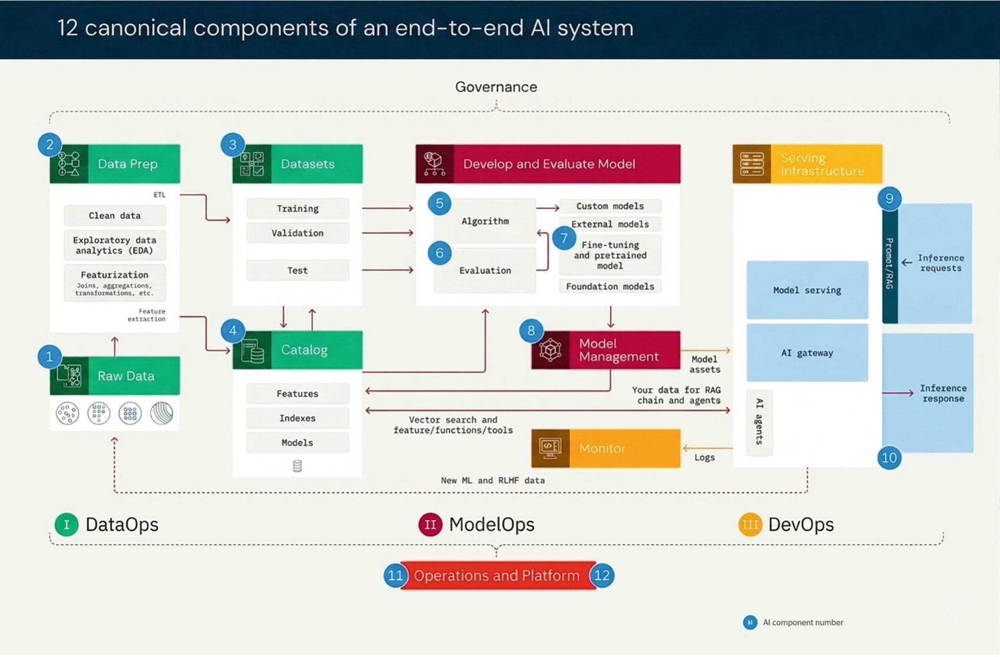

# Databricks Data Intelligence Platform v2

This repository contains the Markdown version of the Databricks Data Intelligence Platform book, converted from EPUB for easier accessibility and analysis.

## Navigating the Data Intelligence Architecture

The transition from passive data storage to active, reasoning AI systems requires a fundamental shift in architecture. The 12 canonical components of an end-to-end AI system diagram presented in Databricks’ AI Security Framework outline this modern blueprint—a framework connecting raw data directly to real-world inference.

This book is structured as a masterclass curriculum, designed to teach you not just the theory but the practical execution of this architecture. It serves as your step-by-step guide to mastering the Databricks platform, giving you the blueprints to build intelligent, governed, and highly scalable products.

## Journey Overview

### 1. The Foundation and the Future
Exploring the shift toward a unified, AI-driven architecture.
* **Databricks Platform: From Lakehouse to Data Intelligence**
* **Generative AI on Databricks: Foundations, Capabilities, and Use Cases**

### 2. Building and Evaluating Agentic AI
Focusing on orchestrating autonomous agents.
* **Composable Agents with Agent Bricks: From Prototype to Production**
* **Agent Bricks Deep Dive: Retrieval, Reasoning, and Tooling Architectures**
* **Agentic AI Design Patterns for Enterprise Systems**
* **Databricks As an Agentic Platform: Orchestration, Context, and Control**
* **Quality Tuning and Evaluation with Agent Bricks**

### 3. Secure, Scalable Infrastructure
Bulletproof compute, state management, and operational security.
* **Lakebase: The OLTP Engine for Intelligent Applications**
* **Building Security-First, Production-Grade Databricks Apps**
* **AI Runtime: Elastic Compute for AI Workloads**
* **MLflow 3 and the GenAI Agents**

### 4. Data Engineering and Governance
The robust engineering required to manage Raw Data, Data Prep, and Datasets.
* **Real-Time Intelligence with Spark Structured Streaming**
* **Lakeflow Connect: Data Ingestion for the Lakehouse**
* **Open Data Governance with Unity Catalog**
* **Delta Lake: The Foundation of Reliable Data and AI**
* **Lakeflow Declarative Pipelines: Managing Data and AI Workflows**
* **Data Warehousing with Databricks SQL**

### 5. Operations and Real-World Execution
Continuous oversight, inference tracking, performance optimization, and cost management.
* **Databricks Pricing and Observability Using System Tables**
* **From Ideation to Creation: Building Intelligent Products with GenAI**
